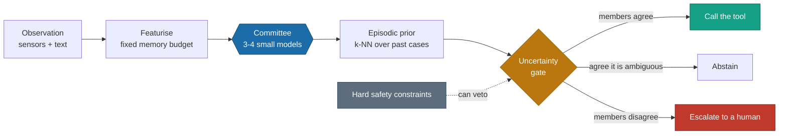

<div align="center">

<br>

# CONCLAVE

### Agentic AI whose brain is a committee of small ML models — not a language model

**Runs offline. No GPU. No API key. The whole agent is 232 KB.**

<br>

[](https://github.com/Aranya69/conclave/actions/workflows/ci.yml)
[](LICENSE)
[](pyproject.toml)
[](deploy/README.md)
[](#resource-cost)
[](#why-this-exists)

<br>

[**Quickstart**](#quickstart) &nbsp;·&nbsp;
[**Deploy to IoT**](#deploy-to-your-own-iot-device) &nbsp;·&nbsp;
[**Guide (PDF)**](docs/CONCLAVE_Guide.pdf) &nbsp;·&nbsp;
[**Paper**](paper/main.pdf) &nbsp;·&nbsp;
[**Results**](#results) &nbsp;·&nbsp;
[**Limitations**](#what-does-not-work)

<br>

</div>

---

## Why this exists

Every mainstream agent framework — LangGraph, CrewAI, AutoGen, the vendor SDKs —
puts a language model at the centre of the sense → decide → act loop. That
imports a dependency on **either a network path to a remote model, or enough
local compute to host one.**

During a flood, a cyclone or an earthquake, cellular and backhaul infrastructure
is among the first things to fail. The hardware that survives runs on batteries.

> **A cloud-backed agent in that moment is not degraded. It is absent.**

A *conclave* is a decision-making body sealed off from outside communication that
must still reach a binding decision — by vote, among its own members, with no way
to phone anyone for help. That is exactly the situation of an autonomous agent
when the towers are down, and it is how this framework works.

```
LLM agents  →  SLM agents (NVIDIA, 2025)  →  no-LM agents (this work)
```

---

## How it works



Every stage is a bounded amount of arithmetic, and none of it touches the
network. There is no autoregressive loop, so **worst-case decision latency is a
constant you can measure and certify.**

| Capability | How | Cost |
|:--|:--|--:|
| Action selection | heterogeneous soft-voting committee | ~2.4 ms |
| Tool routing | pairwise ranking over (request, tool-spec) | ~4 ms · 631 KB |
| Abstention | learned relevance detection | ~0.1 ms · 0.92 AUC |
| Uncertainty | aleatoric/epistemic split, free from the committee | included |
| Planning | cost-optimal search over tool preconditions | µs |
| Memory | bounded k-NN case store | kilobytes |
| Safety | hard constraints above the learned policy | — |

---

## Quickstart

```bash
git clone https://github.com/Aranya69/conclave && cd conclave
pip install -e ".[boost]"
pytest -q                      # 14 passed, ~6 s
```

Then watch it work:

```bash
python demo.py episode         # the agent decides as the network fails
python demo.py route           # type a request, see which tool it picks
python demo.py uncertainty     # break the sensors, watch the committee split
python demo.py speed           # single-decision latency on your CPU
```

<details>
<summary><b>What <code>demo.py episode</code> prints — and why the <code>net</code> column is the whole thesis</b></summary>

<br>

```
    t  level   rain  risk  net | action            conf disagr      gate    ms
   12   2.76   0.69  0.46 DOWN | monitor           1.00   0.00       act   5.0
   13   2.62   3.00  0.58 DOWN | issue_alert       0.50   0.28       act   4.0
   14   3.39   6.38  0.76   up | evacuate_zone     0.98   0.01       act   6.0
   15   8.94   9.26  1.00   up | escalate          0.67   0.35  escalate   4.8
```

`net` says `DOWN` for long stretches and nothing changes — the agent keeps
working. At `t=15` the surge hits, the committee splits (disagreement 0.35), and
the gate **escalates instead of guessing**.

</details>

---

## Deploy to your own IoT device

Three stages. **You do not need the hardware for the first two.**

### 1 · Build an agent for your device

Copy [`examples/pump_station.py`](examples/pump_station.py) — a complete agent in
one file — and change three things: your tools, your sensor names, your training
examples.

```python
from conclave import Agent, EnsembleBrain, Observation, ToolRegistry, UncertaintyGate
from conclave.brain.featurize import (BudgetedTextFeaturizer, FusedFeaturizer,
                                      TabularFeaturizer)
from conclave.tools.base import tool

@tool(description="Start the borehole pump to refill the tank")
def start_pump(minutes: int = 30) -> str:
    return gpio_pump_on(minutes)

@tool(description="Open the chlorine doser", irreversible=True)
def dose_chlorine(ml: int = 50) -> str:
    return gpio_dose(ml)

registry = ToolRegistry([start_pump, dose_chlorine])

# Your logged decisions: sensor readings + optional free text -> action taken
fz = FusedFeaturizer(
    text=BudgetedTextFeaturizer(n_word_features=2**12, n_char_features=2**12),
    tabular=TabularFeaturizer()).fit(observations)

brain = EnsembleBrain().fit(fz.transform(observations), labels)
agent = Agent(brain=brain, featurizer=fz, registry=registry, gate=UncertaintyGate())

d = agent.decide(Observation(features=read_sensors(), text=read_radio()))
print(d.action, d.confidence, d.disagreement, d.gate)
```

### 2 · Verify it fits your board — without owning one

```bash
docker run --privileged --rm tonistiigi/binfmt --install arm64
docker buildx build --platform linux/arm64 -f deploy/Dockerfile.pi4 -t conclave:pi4 --load .
docker compose -f deploy/docker-compose.pi4.yml run --rm zero2w python deploy/pi_check.py
```

That runs a genuine `aarch64` userland with a **real** 512 MB cgroup ceiling.

| Measurement | Under emulation |
|:--|:--|
| ARM wheel availability | **Valid** — and only obtainable this way |
| Correctness / accuracy | **Valid** |
| Model artefact size | **Valid** |
| Peak RSS, fits-in-RAM | **Valid** — the cgroup limit is real |
| Decision latency | *Invalid* — QEMU is 5–20× slower, non-uniformly |
| Energy per decision | *Invalid* — derived from latency |

[`pi_check.py`](deploy/pi_check.py) detects emulation and marks its own timing
block invalid, so you cannot quote a QEMU number by accident.

> [!IMPORTANT]
> **Use 64-bit Raspberry Pi OS.** None of numpy, scipy, scikit-learn, lightgbm or
> psutil publish `armv7l` wheels on PyPI; all publish `aarch64`. On 32-bit,
> `pip install scipy` means *compiling scipy on the Pi* — hours of build time that
> often dies of memory exhaustion on a 1 GB board.

### 3 · Ship the artefact, not the pipeline

```python
# workstation
import joblib
joblib.dump({"fz": fz, "brain": brain, "gate": brain.gate}, "agent.joblib", compress=3)
```

```python
# device — no pandas, no matplotlib, no training data
b = joblib.load("agent.joblib")
agent = Agent(brain=b["brain"], featurizer=b["fz"], registry=registry, gate=b["gate"])
while True:
    d = agent.decide(Observation(features=read_sensors(), text=read_radio()))
    log(d.action, d.confidence, d.disagreement, d.gate)
```

Runtime dependencies collapse to numpy, scipy, scikit-learn and joblib — about
60 MB of wheels plus a 200 KB agent.

> [!WARNING]
> `joblib.load` unpickles, which executes code. Only load artefacts you produced
> yourself or received over a channel you trust. This matters the moment you push
> model updates to field devices.

Full detail: **[`deploy/README.md`](deploy/README.md)** and §5 of the guide.

---

## Uncertainty is the control flow

A single model gives you a prediction and a confidence number. A committee gives
you the **spread of opinion**, which separates two situations a single model
cannot tell apart:

| Aleatoric | Epistemic | Meaning | Gate fires |
|:--:|:--:|:--|:--|
| low | low | Clear-cut | `ACT` |
| **high** | low | Genuinely ambiguous — more data will not help | `ABSTAIN` |
| low | **high** | Members disagree — out of competence | `GATHER` / `ESCALATE` |
| high | high | Hard *and* unfamiliar | `ESCALATE` |

```python
from conclave.brain.uncertainty import decompose
stats = decompose(brain.member_proba(X)[:, 0, :])
stats.aleatoric   # committee agrees it is ambiguous
stats.epistemic   # committee disagrees — it does not know
```

The decomposition is the BALD mutual-information identity (Houlsby et al., 2011),
repurposed from *"which example should I label"* to *"should I act at all"*.
§6 of the [guide](docs/CONCLAVE_Guide.pdf) derives it.

---

## Results

Reproduce with `python scripts/run_all.py`. Every experiment writes a JSON
artefact to `results/` recording platform, seed and commit.

<table>
<tr><td valign="top" width="50%">

**Tool routing** · BFCL v3

| Split | Lexical | **CONCLAVE** |
|:--|--:|--:|
| `multiple` | 90.0% | **98.3%** |
| `live_multiple` | 79.4% | **90.8%** |
| unseen tools | 56.7% | **78.9%** |

*4 ms per decision, 631 KB model*

</td><td valign="top" width="50%">

**Crisis triage** · HumAID

| Model | wF1 | Size |
|:--|--:|--:|
| RoBERTa *(reported)* | 0.760 | ~500 MB |
| FastText *(reported)* | 0.744 | — |
| **CONCLAVE 2¹⁶** | **0.743** | 36 MB |
| SVM *(reported)* | 0.731 | — |
| **CONCLAVE 2¹²** | **0.713** | **2.6 MB** |

</td></tr>
</table>

**Availability under connectivity loss.** The cloud baseline is given an
***oracle*** policy — it sees the simulator's latent risk, which no real language
model would. So any gap is **availability alone**, not capability.

| Steps offline | CONCLAVE | Cloud oracle | Δ (95% CI) |
|--:|--:|--:|:--|
| 0% | 36.5 | 35.8 | `+0.6 [-0.7, 1.9]` — **no difference** |
| 35% | 33.9 | −34.2 | `+68.1 [57.6, 78.9]` |
| 53% | 34.3 | −77.7 | `+112.0 [100.6, 123.6]` |
| 73% | 33.5 | −127.3 | `+160.8 [148.5, 173.0]` |

The tie at 0% is the important row: it confirms the comparison is fair before the
gap opens.

### Resource cost

| Board | Est. mean | Est. p99 | Fits RAM |
|:--|--:|--:|:--:|
| Host (2-core x86) | 2.5 ms | 3.1 ms | yes |
| Raspberry Pi 4B | 8.7 ms | 13.0 ms | yes |
| Raspberry Pi 3B+ | 14.3 ms | 16.9 ms | yes |
| Pi Zero 2 W | 22.6 ms | 30.6 ms | yes |

*Core counts and RAM ceilings are enforced; on-device latency is a stated scaling
model, not a measurement — see [Limitations](#what-does-not-work).*

---

## What does *not* work

Reported because negative results are results.

- **The aleatoric/epistemic split does not beat plain max-probability
  confidence** on selective prediction or shift detection here (AUROC 0.955 vs
  0.960 on novel text). The theory is clean; the measurement did not support it.
- **Uncertainty-triggered human oversight lost to _random_ oversight** in the
  sequential task. Instantaneous uncertainty clusters in time, so escalations
  bunch up early while random spreads them across the episode. In a sequential
  problem, *when* a decision matters is as important as how uncertain it is.
- **Text features are lexical.** Hashed n-grams have no compositional semantics,
  so paraphrase and negation hurt more than they hurt a transformer.
- **Peak RSS is ~200 MB**, dominated by the Python runtime — the *agent* is
  232 KB. Microcontroller-class deployment needs a reimplementation.
- **On-device latency is a scaling model, not a measurement.** No Raspberry Pi
  was used in this work. If you have one,
  [please file a hardware report](.github/ISSUE_TEMPLATE/hardware_report.md) —
  it is the single most valuable contribution to this project.

## When to use this

| Use an LLM agent | Use CONCLAVE |
|:--|:--|
| Open-ended action space | Enumerable tool set |
| Free-form task spec, varying each time | Recurring, structured decisions |
| Novel plan composition required | Sensor-driven control loop |
| Connectivity and compute available | Connectivity-denied or power-constrained |
| Latency tail can vary | Worst-case latency must be certified |

---

## Documentation

| | |
|:--|:--|
| **[`docs/CONCLAVE_Guide.pdf`](docs/CONCLAVE_Guide.pdf)** | 28-page guide: Windows/VS Code setup, using the framework, the models, Raspberry Pi deployment, and where every equation comes from |
| [`RUNNING.md`](RUNNING.md) | The short version of setup |
| [`deploy/README.md`](deploy/README.md) | IoT deployment specifics |
| [`paper/main.pdf`](paper/main.pdf) | The research paper |
| [`examples/pump_station.py`](examples/pump_station.py) | A complete agent in one file |
| [`CONTRIBUTING.md`](CONTRIBUTING.md) | How to help |

## Repository layout

```
conclave/
├── core/         agent loop, typed observations/actions/episodes, tool registry
├── brain/        committee, tool router, uncertainty, budgeted featurisers
├── planning/     precondition/effect planner, hard safety constraints
├── memory/       bounded k-NN episodic case store
├── edge/         device profiles, constraint enforcement, profiling
└── envs/         flood-response simulation with connectivity outages

deploy/           Dockerfile + compose for emulated ARM64, pi_check.py
examples/         a complete agent in one file
experiments/      exp1–exp5 + figure generation
docs/             the practical guide (LaTeX source + PDF)
paper/            the research paper
tests/            14 tests, incl. paper-claim verification
```

## Data

Datasets are **not committed** — they belong to their authors and carry their own
licences. `exp3`, `exp4` and `exp5` need no data at all.

```bash
python scripts/fetch_data.py     # ~19 MB, only needed for exp1 and exp2
```

> [!NOTE]
> **A word on flood datasets.** We discarded a widely-used Bangladesh flood
> dataset after finding its `Flood?` label is essentially a rainfall threshold:
> a depth-1 stump on rainfall alone scores 98.4%, and 92% of rows are positive.
> Any model "succeeds" on it. Audit your labels.

## Citing

```bibtex
@article{mahmud2026conclave,
  title  = {CONCLAVE: Agentic AI Without a Language Model --- Ensemble Machine
            Learning as the Cognitive Core for Connectivity-Denied Autonomous
            Systems},
  author = {Mahmud, Aranya},
  year   = {2026}
}
```

## Contributing

See [CONTRIBUTING.md](CONTRIBUTING.md). One rule worth stating up front:
`tests/test_paper_claims.py` **fails on purpose** when a result moves. That is the
mechanism keeping the paper and the code honest — investigate before you change a
threshold.

## License

[Apache-2.0](LICENSE)

<div align="center">
<br>
<sub>Built for the places where the network is not.</sub>
</div>
